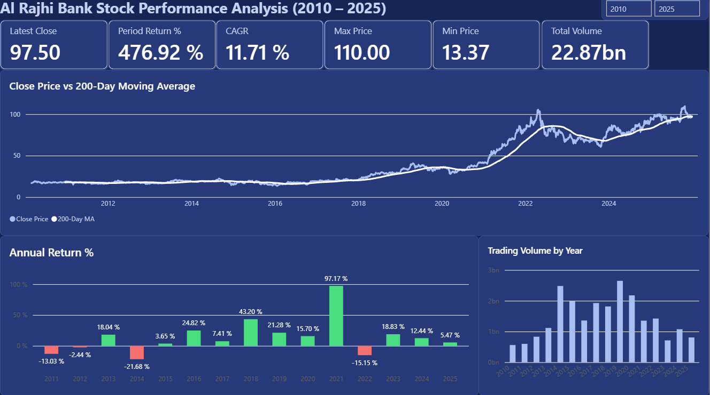

# Al Rajhi Bank Stock Analysis (2010–2025)

## Project Overview

This project presents a historical analysis of Al Rajhi Bank's stock market performance from 2010 to 2025 using Microsoft Power BI.

The objective is to analyze historical stock price movements, investment returns, and trading activity through an interactive dashboard that transforms raw historical market data into meaningful insights.

## Tools & Technologies

- Microsoft Power BI
- DAX (Data Analysis Expressions)
- Power Query
- Microsoft Excel
- Data Cleaning & Preparation
- Data Analysis
- Data Visualization

## Project Highlights

- **Raw Data Processing:** Worked with raw historical stock market data and prepared it for analysis.
- **Data Cleaning & Preparation:** Cleaned and transformed the dataset using Power Query to improve data consistency and analytical readiness.
- **Financial KPI Development:** Created financial performance measures using DAX.
- **Historical Stock Analysis:** Analyzed long-term stock price movements from 2010 to 2025.
- **Moving Average Analysis:** Implemented a 200-Day Moving Average to examine long-term price trends.
- **Investment Performance Analysis:** Calculated Period Return, CAGR, and Annual Returns.
- **Trading Volume Analysis:** Examined historical trading activity and annual volume patterns.
- **Interactive Dashboard Development:** Built an interactive Power BI dashboard to present financial data and performance indicators.

## Key Performance Indicators (KPIs)

- Latest Closing Price
- Period Return (%)
- Compound Annual Growth Rate (CAGR)
- Maximum Stock Price
- Minimum Stock Price
- Total Trading Volume

## Dashboard Preview



## Power BI Dashboard & Project File

Explore and download the complete Power BI project:

- **[Download Power BI Project (.pbix)](PowerBI/AlRajhi-Bank-Stock-Analysis.pbix)**
- **[View Dashboard Screenshot](Screenshots/Dashboard.png)**

The Power BI project includes the interactive dashboard, data model, Power Query transformations, and DAX measures.

To explore the interactive dashboard, download the `.pbix` file and open it using Microsoft Power BI Desktop.

## Key Findings

The analysis of Al Rajhi Bank's stock performance from 2010 to 2025 revealed the following findings:

### Overall Performance

- **Period Return:** The stock recorded a cumulative return of 476.92% over the selected analysis period.
- **Compound Annual Growth Rate (CAGR):** The annualized growth rate reached 11.71%.
- **Latest Closing Price:** SAR 97.50.
- **Maximum Stock Price:** SAR 110.00.
- **Minimum Stock Price:** SAR 13.37.
- **Total Trading Volume:** Approximately 22.87 billion shares.

### Annual Performance Highlights

- **Best Performing Year:** 2021 recorded the highest annual return at 97.17%.
- **Worst Performing Year:** 2014 recorded the lowest annual return at -21.68%.
- **2022 Performance:** The stock recorded a negative annual return of -15.15%.
- **2023 Performance:** The stock recovered with an annual return of 18.83%.
- **2024 Performance:** The stock achieved an annual return of 12.44%.
- **2025 Performance:** The stock recorded an annual return of 5.47%.

### Market Observations

- The stock experienced significant growth during 2020–2022, with 2021 representing the strongest annual performance in the displayed analysis.
- The market experienced a notable correction in 2022.
- Positive annual returns in 2023, 2024, and 2025 indicate a recovery in the stock's performance following the 2022 decline.
- Annual returns varied considerably throughout the analysis period, highlighting changes in historical market performance.

*All figures are based on the Power BI dashboard and the selected analysis period. Historical performance does not guarantee future returns.*

## Analysis Features

### 1. Historical Stock Price Analysis

- Historical stock price trends from 2010 to 2025.
- 200-Day Moving Average to examine long-term price trends.
- Identification of maximum and minimum stock prices.

### 2. Investment Performance Analysis

- Period Return (%) to measure stock performance over the selected period.
- CAGR to evaluate the annualized growth rate.
- Annual Return (%) to compare yearly performance.

### 3. Trading Volume Analysis

- Total trading volume.
- Annual trading volume comparison.
- Analysis of historical trading activity.

## Data Cleaning & Preparation

The original dataset was processed using Microsoft Power Query in Power BI.

The preparation process included:

- Promoting the first row to column headers.
- Converting the Date column to the Date data type.
- Converting financial and trading volume columns to numeric data types.
- Reordering columns for consistency.
- Rounding numeric values to two decimal places.
- Applying a specific filtering rule to exclude records matching defined volume, closing price, and date conditions.

Both the original raw dataset and the cleaned dataset are maintained separately for transparency and reproducibility.

## Data Source

The dataset was obtained from Kaggle:

- **Dataset:** Al Rajhi Bank Stock Data Analysis (2010–2025)
- **Author:** Hassan Jameel Ahmed
- **Source:** [Kaggle Dataset](https://www.kaggle.com/datasets/hassanjameelahmed/al-rajhi-stock-data-analysis-20102025)
- **Stock Symbol:** 1120.SR
- **Coverage:** March 2010 – December 2025
- **Original Records:** 3,926 daily trading records

### Dataset Files

- `Data/AL_Rjehei.csv` – Original raw dataset.
- `Data/AL_Rjehei_Cleaned.csv` – Cleaned and prepared dataset.

## Project Structure

```text
AlRajhi-Bank-Stock-Analysis/
│
├── Data/
│   ├── README.md
│   ├── AL_Rjehei.csv
│   └── AL_Rjehei_Cleaned.csv
│
├── PowerBI/
│   ├── README.md
│   └── AlRajhi-Bank-Stock-Analysis.pbix
│
├── Screenshots/
│   ├── README.md
│   └── Dashboard.png
│
└── README.md
